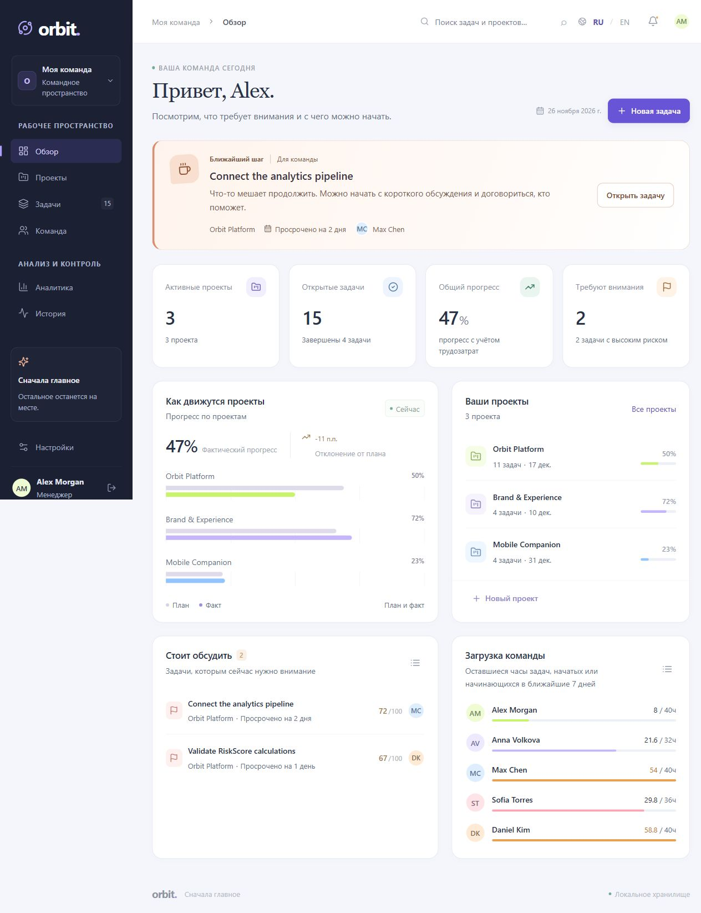
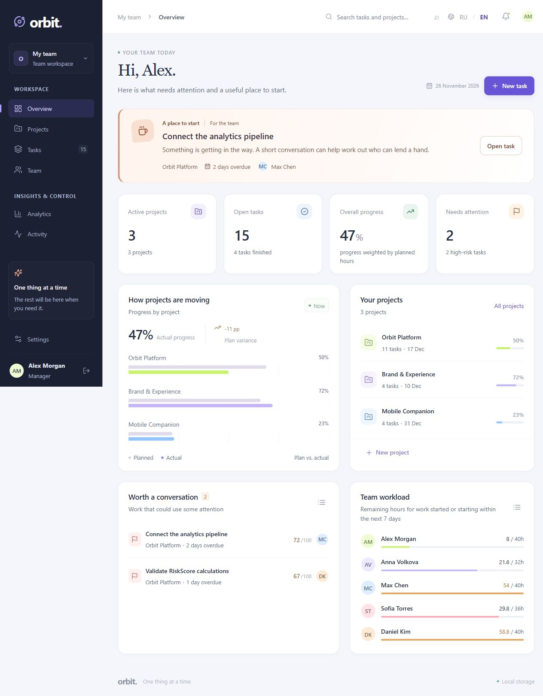

# Orbit

Место для задач, договорённостей и людей, которые делают проект. Русский и английский интерфейс.

A place for tasks, decisions, and the people doing the work. Russian and English interfaces.

**[Полный гайд на русском](#ru) · [Full guide in English](#en)**



<a id="ru"></a>
## Русский: руководство пользователя и запуск

Orbit помогает команде планировать проекты, распределять задачи и следить за прогрессом. Канбан-доска, комментарии, оценка рисков и контрольные снимки собраны в одном приложении с русским и английским интерфейсом. Основные технологии: React, Express и MongoDB. Для быстрого локального запуска предусмотрено сохранение в JSON-файл без установки базы данных.

### С чего начать

Уже хотите попробовать? Откройте [инструкцию запуска](#ru-start). Для первой прогулки по приложению есть [пример с небольшой командой](#ru-example). Если нужна своя рабочая база, переходите к [настройке команды](#ru-own-team).

В Orbit не нужно сразу описывать весь проект. Начните с нескольких задач, назначьте людей и уточняйте план по ходу работы. Ниже разобраны и обычные действия, и детали расчётов.

### Содержание

- [1. Как устроена работа](#ru-workflow)
- [2. Установка и запуск](#ru-start)
- [3. Вход и язык](#ru-login)
- [4. Разделы и навигация](#ru-navigation)
- [5. Роли и доступ](#ru-roles)
- [6. Участники команды](#ru-team)
- [7. Проекты](#ru-projects)
- [8. Задачи, подзадачи и зависимости](#ru-tasks)
- [9. Поиск, фильтры и CSV](#ru-search)
- [10. Оценка риска](#ru-risk)
- [11. План, факт и нагрузка](#ru-analytics)
- [12. Контрольные снимки](#ru-snapshots)
- [13. История и настройки](#ru-settings)
- [14. Пример рабочего сценария](#ru-example)
- [15. Своя команда без демоданных](#ru-own-team)
- [16. MongoDB и Docker](#ru-mongo)
- [17. Настройки окружения](#ru-environment)
- [18. Сохранность и резервные копии](#ru-backups)
- [19. Решение проблем](#ru-troubleshooting)
- [20. Разработка и проверки](#ru-development)
- [21. Перенос в GitHub](#ru-github)
- [22. Границы текущей версии](#ru-limitations)

<a id="ru-workflow"></a>
### 1. Как устроена работа

Основная последовательность: **участники → проект → задачи → обновление выполнения → анализ → контрольный снимок**.

Менеджер собирает команду, записывает задачи и договаривается о сроках. Исполнитель обновляет состояние своих задач, затраченные часы и прогресс. Приложение рассчитывает показатели и риски из этих данных. Менеджер проверяет отклонения и сохраняет снимки, чтобы сравнивать результаты со временем.

Изменения в форме записываются после нажатия **«Сохранить»**. Закрытие формы, Escape или «Отмена» отбрасывают несохранённые правки. Перетаскивание задачи на доске сохраняет новый статус сразу. Комментарий отправляется отдельной кнопкой и сохраняется независимо от остальных полей формы.

Данные находятся на сервере. После собственных изменений экран обновляется сразу; изменения других пользователей подгружаются примерно раз в минуту, пока вкладка видима, и при возвращении фокуса в окно.

<a id="ru-start"></a>
### 2. Установка и запуск

#### На компьютере, где проект уже подготовлен

1. Откройте папку проекта и дважды нажмите [START-ORBIT.cmd](START-ORBIT.cmd).
2. Дождитесь сборки и сообщения `Orbit API ready`.
3. Откройте [http://127.0.0.1:3000](http://127.0.0.1:3000).
4. Оставьте окно запуска открытым на время работы.

Этот файл собирает интерфейс перед запуском и ищет Node.js в системе, а затем в установленном локальном Codex. Зависимости должны быть установлены заранее. Если сервер уже работает, достаточно открыть адрес, второй запуск не нужен.

#### На новом компьютере

Нужны **Node.js 22.12 или новее**, npm и доступ к интернету для установки зависимостей. Откройте терминал в папке с `package.json`:

```sh
npm install -g pnpm@11.25.0
pnpm install --frozen-lockfile
pnpm build
pnpm start
```

Откройте [http://127.0.0.1:3000](http://127.0.0.1:3000). Для первого знакомства `.env` и MongoDB не нужны: приложение создаст демонстрационные данные в `.data/orbit.json`.

Для остановки нажмите **Ctrl+C** в окне сервера. Для следующего запуска достаточно `pnpm start` или `START-ORBIT.cmd`. После изменения исходников перед `pnpm start` выполните `pnpm build`. Локальные данные сохраняются при остановке и перезапуске.

<a id="ru-login"></a>
### 3. Вход и язык

При стандартном демонстрационном запуске нажмите **«Открыть демопространство»** либо введите:

| Поле | Значение |
| --- | --- |
| Email | `demo@orbit.local` |
| Пароль | `OrbitDemo2026!` |
| Роль | Менеджер |

Первый запуск деморежима создаёт три проекта, 18 задач, пять участников и исходные снимки. Эти записи можно изменять; приложение не сбрасывает их при следующем запуске. Даты рассчитываются при создании базы, поэтому со временем демозадачи могут становиться просроченными.

**RU / EN** переключает язык на экране входа и в верхней панели. Выбор также доступен в «Настройках» и сохраняется в текущем браузере. Переводятся элементы интерфейса и системные сообщения. Названия проектов, задач, комментарии и имена участников остаются в том виде, в котором их ввели.

Сессия действует до 12 часов. Перезапуск сервера завершает все сессии; нужно войти снова. Кнопка выхода находится рядом с профилем внизу боковой панели. Самостоятельной регистрации и восстановления пароля по почте нет.

<a id="ru-navigation"></a>
### 4. Разделы и навигация

| Раздел | Для чего нужен |
| --- | --- |
| **Обзор** | Активные проекты, открытые задачи, общий прогресс, задачи с риском, план/факт и нагрузка |
| **Проекты** | Создание и редактирование проектов, состав команды, переход к задачам |
| **Задачи** | Канбан-доска, таблица, карточки задач, поиск, фильтры и экспорт |
| **Команда** | Участники, роли, недельная ёмкость и оставшиеся часы |
| **Аналитика** | Плановый и фактический прогресс, часы, рекомендации, снимки и сравнение |
| **История** | События проекта с автором и временем |
| **Настройки** | Профиль, язык, текущее хранилище и версия приложения |

В «Обзоре» есть персональное приветствие и блок «Ближайший шаг». Он предлагает одну открытую задачу и объясняет выбор: сначала блокировки, затем просрочки, проверка, сегодняшний срок и высокий риск. При равных условиях выбирается ближайший срок. Менеджер видит работу команды, участник только свои назначения в выбранных проектах. Кнопка открывает карточку; никаких изменений за вас приложение не делает.

Выбор конкретного проекта сохраняется при переходе между разделами. Чтобы увидеть всю доступную работу, выберите **«Все проекты»** в списке проектов. «Все» означает данные, доступные вашей учётной записи. На узком экране боковая панель открывается кнопкой меню, доска и широкие таблицы прокручиваются горизонтально.

<a id="ru-roles"></a>
### 5. Роли и доступ

| Возможность | Участник | Менеджер | Администратор |
| --- | --- | --- | --- |
| Просмотр проектов, задач, истории и снимков | В проектах, куда добавлен | В проектах, куда добавлен | Во всех проектах |
| Комментарии к доступным задачам | Да | Да | Да |
| Изменение статуса, прогресса, фактических часов и отметок подзадач | Только у назначенных ему задач | У доступных задач | У любых задач |
| Создание, полное редактирование и удаление проектов и задач | Нет | В пределах доступа | Да |
| Перетаскивание карточек на доске | Нет; статус меняется в форме своей задачи | Да | Да |
| Создание и удаление снимков | Нет | В пределах доступа | Да |
| Создание учётных записей | Нет | Только роль «Участник» | Любая роль |
| Изменение профилей | Нет | Свой профиль и профили участников | Все профили |
| Изменение роли другого пользователя | Нет | Нет | Да |

Администратор не может изменить собственную роль. Менеджер не может исключить себя из своего проекта. Участник видит и чужие задачи своего проекта, но редактирует только разрешённые поля назначенных ему задач. Доступ проверяется сервером.

<a id="ru-team"></a>
### 6. Участники команды

1. Откройте **«Команда» → «Добавить участника»** под менеджером или администратором.
2. Введите имя и уникальный email.
3. Задайте недельную ёмкость: от **1 до 168 часов**, по умолчанию 40. Это доступное время для расчёта нагрузки.
4. Администратор может выбрать роль; менеджер создаёт только участников.
5. Для входа нового пользователя задайте пароль из **12-128 символов**. Если оставить поле пустым, запись можно использовать для назначения задач, но входить с ней нельзя.
6. Сохраните участника и добавьте его в состав нужного проекта через редактирование проекта.

Участник не получает доступ к проекту только от появления в разделе «Команда». Его нужно включить в список **«Доступ к проекту»**. В форме нового проекта изначально отмечены все доступные участники: перед сохранением оставьте нужных.

Меню с тремя точками на карточке участника открывает редактирование профиля и ёмкости. В текущем интерфейсе пароль задаётся только при создании; изменение паролей существующих пользователей доступно через [API](docs/API.md). Администратор может менять чужие пароли, менеджер: свой. Смена пароля завершает сессии этого пользователя. Удаления пользователей через интерфейс нет.

При выборе проекта карточки нагрузки учитывают этот проект; верхние показатели общего количества участников и суммарной ёмкости относятся ко всем участникам, видимым пользователю.

<a id="ru-projects"></a>
### 7. Проекты

1. Откройте **«Проекты» → «Новый проект»**.
2. Укажите название, описание, дату начала и срок завершения. Срок не может быть раньше начала.
3. Выберите цвет, статус и участников.
4. Нажмите **«Сохранить»**. Создатель автоматически включается в проект.

Название проекта или **«Открыть задачи»** переводит на доску этого проекта. Три точки на карточке открывают редактирование.

| Статус | Назначение |
| --- | --- |
| В работе | Активный проект; учитывается в счётчике активных проектов |
| На паузе | Работа временно приостановлена |
| Завершён | Проект отмечен завершённым |
| В архиве | Проект сохранён для дальнейшего просмотра |

Статус проекта задаётся вручную. Завершение всех задач не меняет его автоматически. Пауза, завершение и архив не блокируют редактирование задач и не исключают их автоматически из общих расчётов. Чтобы вернуть архивный проект в работу, измените его статус.

Перед исключением участника переназначьте или снимите назначение со всех его задач этого проекта, включая завершённые. **Удаление проекта** после подтверждения удаляет также его задачи, комментарии внутри задач, события и снимки. Встроенной отмены удаления нет.

<a id="ru-tasks"></a>
### 8. Задачи, подзадачи и зависимости

Нажмите **«Новая задача»** в «Обзоре» или «Задачах», либо плюс в колонке доски. Если проектов ещё нет, сначала откроется создание проекта. При режиме «Все проекты» проверьте поле проекта в форме: по умолчанию выбирается первый доступный.

| Поле | Как заполнять |
| --- | --- |
| Название и описание | Краткий результат и условия выполнения |
| Проект | Проект, к которому относится задача; после создания менять его нельзя |
| Исполнитель | Один участник выбранного проекта или «Не назначен» |
| Статус | Текущий этап работы |
| Приоритет | Низкий, средний, высокий или срочный; задаётся вручную |
| Дата начала и срок | Две календарные даты; срок не раньше начала |
| Плановые часы | Оценка трудозатрат; по умолчанию 8 часов |
| Затрачено часов | Введённый вручную суммарный факт, а не добавка к предыдущему значению |
| Прогресс | Ручная оценка готовности от 0 до 100% |

На доске пять колонок:

| Статус | Обычное применение |
| --- | --- |
| Запланировано | Задача подготовлена, работа ещё не начата |
| В работе | Исполнитель выполняет задачу |
| На проверке | Результат ожидает проверки |
| Готово | Задача завершена; прогресс устанавливается в 100%, риск: в 0 |
| Заблокировано | Есть препятствие; компонент блокировки в оценке риска становится максимальным |

Менеджер и администратор могут перетаскивать карточки между колонками. На телефоне и для исполнителя своей задачи используйте поле статуса в форме. Порядок переходов не ограничен. Если вернуть готовую задачу в работу, её прогресс останется 100% до ручного изменения. Само значение 100% не переводит задачу в «Готово».

**Подзадачи.** Менеджер добавляет пункты и удаляет их. Исполнитель своей задачи отмечает выполнение. Подзадачи: чек-лист без отдельных сроков и исполнителей. Отметки не пересчитывают автоматически прогресс основной задачи.

**Зависимости.** В поле «Зависит от задач» выберите работы, которые должны быть завершены раньше. Допустимы только задачи того же проекта. Самоссылки и циклы, например A → B → A, отклоняются. Незавершённая зависимость повышает риск, но не меняет статус автоматически и не запрещает вручную завершить задачу. При удалении задачи ссылки на неё удаляются из зависимостей других задач.

**Комментарии.** Сначала сохраните задачу, затем откройте её и используйте блок «Обсуждение». Комментарий может отправить любой пользователь с доступом к проекту. Сохраняются автор, текст и время; отправка обновляет время активности задачи. Редактирования и удаления комментариев в интерфейсе нет.

Часы и прогресс вводятся независимо: таймера нет, внесение часов не меняет процент готовности. Счётчик завершённых задач учитывает статус «Готово». Дедлайн действует до конца указанного дня по UTC; выходные и праздники из расчётов не исключаются.

<a id="ru-search"></a>
### 9. Поиск, фильтры и CSV

- В разделе «Проекты» верхний поиск ищет по названию и описанию проекта.
- В остальных разделах ввод в верхний поиск открывает «Задачи» и ищет по названию, описанию, названию проекта и имени исполнителя. Поиск не учитывает регистр.
- Задачи фильтруются по проекту, статусу и приоритету. Переключатель **«Доска / Список»** меняет представление тех же данных.
- Колокольчик открывает незавершённые задачи с риском **от 35 баллов из 100**. Снять этот фильтр можно крестиком на его кнопке.
- Если результат пуст, нажмите «Показать все задачи» или очистите поисковую строку и верните «Все проекты», «Все статусы» и «Все приоритеты».

**«Экспорт CSV»** выгружает только задачи, прошедшие текущие фильтры и поиск. Файл `orbit-tasks-YYYY-MM-DD.csv` содержит название, проект, статус, исполнителя, приоритет, срок, прогресс, плановые и фактические часы, RiskScore. Заголовки, статусы и приоритеты используют текущий язык интерфейса; введённые пользователями тексты сохраняются как есть.

Файл использует UTF-8 и разделитель-запятую. Если табличный редактор показывает всё в одной колонке, импортируйте CSV с этими параметрами. Комментарии, подзадачи и зависимости в экспорт не входят. Обратного импорта CSV нет.

<a id="ru-risk"></a>
### 10. Оценка риска

RiskScore помогает выбрать задачи, которые стоит проверить в первую очередь. На экране это шкала **0-100**; даже если рядом показан знак `%`, значение не является вероятностью срыва срока.

```text
RiskScore = 0.30 × D + 0.25 × P + 0.20 × W + 0.15 × B + 0.10 × A
```

Все компоненты и внутренний результат находятся в диапазоне 0…1; для отображения итог умножается на 100.

| Фактор | Вес | Как влияет |
| --- | --- | --- |
| D: дедлайн | 30% | Растёт в последние 7 суток до конца дня срока; после срока равен 1 |
| P: отставание прогресса | 25% | Положительная разность планового и фактического прогресса, делённая на 100 |
| W: перегрузка | 20% | Отношение оставшихся часов исполнителя к недельной ёмкости минус 1; ограничено диапазоном 0…1 |
| B: блокировка | 15% | Равен 1 при статусе «Заблокировано» или незавершённой зависимости, иначе 0 |
| A: неактивность | 10% | Время с последнего обновления задачи, делённое на 7 суток; максимум 1 |

Низкий риск: внутренний балл **ниже 0,35**; средний: **от 0,35 включительно до 0,65 не включительно**; высокий: **от 0,65**. Число на карточке округлено, поэтому уровень определяется по внутреннему значению до округления до целого на экране.

Карточка **«Требуют внимания»** в «Обзоре» считает высокий риск. Список «Стоит обсудить» и колокольчик включают также средний риск. Приоритет задачи не входит в формулу. Для завершённой задачи все компоненты и итоговый риск равны нулю.

Откройте сохранённую задачу, чтобы увидеть вклад факторов. Значения пересчитываются при загрузке данных; они могут меняться с течением времени без редактирования. После сохранения правок заново откройте карточку для актуального разбора. При переходе редактируемой задачи в высокий риск создаётся событие в истории. Отдельной фоновой рассылки предупреждений нет.

<a id="ru-analytics"></a>
### 11. План, факт и нагрузка

**Плановый прогресс** линейно увеличивается от начала задачи до конца дня её срока. **Фактический прогресс** берётся из введённого процента. Прогресс проекта и общая сводка взвешиваются по плановым часам:

```text
Прогресс = сумма(прогресс задачи × плановые часы) / сумма(плановые часы)
```

Например, задача на 4 часа выполнена на 100%, а задача на 12 часов: на 0%: общий прогресс **25%**. Если у всех задач нулевые плановые часы, используется простое среднее; без задач результат равен 0. Итог округляется до целого процента.

Отклонение: факт минус план: 40% при плане 60% дают **−20 процентных пунктов**. Плановые и фактические трудозатраты: суммы соответствующих часов; приложение не вычисляет стоимость работ.

**Нагрузка** оценивается по оставшимся часам:

```text
Остаток задачи = плановые часы × (1 − прогресс / 100)
```

Учитываются незавершённые задачи, уже начатые или начинающиеся в ближайшие семь суток. Часы сравниваются с недельной ёмкостью участника. При 48 оставшихся часах и ёмкости 40 показана перегрузка. Фактически затраченные часы напрямую из остатка не вычитаются. Это оценка очереди работ: длинные задачи не распределяются по отдельным дням календаря.

Карточки нагрузки в интерфейсе учитывают выбранный проект или все доступные проекты. Компонент нагрузки в RiskScore рассчитывается сервером по всем задачам исполнителя в базе, поэтому при выборе одного проекта он может отражать большую нагрузку, чем показано в его карточке.

В «Аналитике» показывается одна рекомендация по порядку: высокий риск → перегрузка → отставание больше 10 процентных пунктов → отсутствие крупных отклонений. Это правила по текущим данным; автоматического переназначения задач нет.

<a id="ru-snapshots"></a>
### 12. Контрольные снимки

1. Откройте **«Аналитика»** и выберите проект.
2. Нажмите **«Сохранить снимок»**.
3. Проверьте проект в форме, задайте понятное имя, например «До проверки прототипа», и сохраните.
4. Обновите задачи и позже создайте второй снимок того же проекта.
5. В блоке сравнения выберите исходный и второй снимки. Для оценки движения вперёд используйте более ранний снимок слева и более поздний справа.

Создать снимок можно и из режима «Все проекты», но в форме нужно выбрать один конкретный проект. Сравниваются только снимки одного проекта. По умолчанию справа выбран самый новый доступный снимок, слева: самый ранний совместимый.

В сравнении отображаются фактический и плановый прогресс, средний риск, число просроченных и завершённых задач, число задач высокого риска и фактические часы. Средний риск включает все задачи проекта, в том числе завершённые с нулевым риском. Просрочены только незавершённые задачи с истёкшим сроком.

Изменение считается как **правый снимок минус левый**. Для процентов используются процентные пункты. Показатели снимка не меняются после последующего редактирования задач. Снимок сохраняет аналитическое состояние, но не позволяет откатить проект и не заменяет резервную копию. Менеджер или администратор может удалить снимок после подтверждения.

<a id="ru-settings"></a>
### 13. История и настройки

«История» показывает события доступных проектов: создание и изменение проектов, создание, изменение, завершение и удаление задач, комментарии, операции со снимками и зафиксированные переходы в высокий риск. События идут от новых к старым, содержат автора, время и название связанного объекта. Это журнал действий без полного сравнения каждого изменённого поля. Удаление проекта удаляет и его историю; изменения профилей участников в эту ленту не записываются.

В «Настройках» видны текущий профиль, роль, язык, версия и режим хранения. Менеджер и администратор могут редактировать свой профиль; у участника кнопка недоступна. Переключение JSON/MongoDB производится настройками сервера, не кнопкой в интерфейсе.

<a id="ru-example"></a>
### 14. Пример рабочего сценария

1. Войдите менеджером, добавьте участника «Тестовый исполнитель» с паролем и ёмкостью 32 часа.
2. Создайте проект «Запуск портфолио» со сроком через две недели и включите этого участника.
3. Создайте «Подготовить макет» на 8 часов и «Сверстать страницу» на 16 часов. Назначьте исполнителя и даты.
4. Во второй задаче укажите зависимость от макета. Добавьте пункты «Шапка», «Основной блок», «Мобильная версия».
5. Сохраните снимок «Старт».
6. Выйдите и войдите учётной записью исполнителя. Откройте макет, поставьте «В работе», 50% и 4 фактических часа, добавьте комментарий.
7. Вернитесь под менеджером: проверьте план/факт, нагрузку и составляющие риска.
8. Завершите макет. У зависимой задачи исчезнет фактор незавершённой зависимости, если нет других причин блокировки. Её статус останется прежним.
9. Сохраните снимок «После макета», сравните его со «Стартом» и выгрузите задачи проекта в CSV.

Этот сценарий демонстрирует права, сохранение данных, зависимости и изменение аналитики без необходимости менять исходный код.

<a id="ru-own-team"></a>
### 15. Своя команда без демоданных

Для работы со своей командой остановите приложение и создайте `.env` на основе [.env.example](.env.example). Если файл уже есть, отредактируйте его. Используйте **новую пустую** папку данных, например вложенную в игнорируемую `.data`:

```dotenv
HOST=127.0.0.1
PORT=3000
STORE=file
DATA_DIR=.data/team
DEMO_MODE=false
ADMIN_EMAIL=admin@team.example
ADMIN_PASSWORD=REPLACE-WITH-YOUR-OWN-PASSWORD
```

Замените пример email и пароль своими значениями; пароль должен содержать минимум 12 символов. Запустите `pnpm start`. Войдите указанными данными: будет создан администратор без демопроектов. Затем создайте участников и первый проект.

`DEMO_MODE=false` отключает демокнопку и демозаполнение **нового** хранилища. Эта настройка не очищает старую базу. `ADMIN_EMAIL` и `ADMIN_PASSWORD` задают первую учётную запись только при первоначальном заполнении и не сбрасывают пароль существующего пользователя. Для нового MongoDB-пространства аналогично используйте отдельное имя базы.

<a id="ru-mongo"></a>
### 16. MongoDB и Docker

#### Собственная MongoDB

Укажите в `.env` подключение к доступному серверу:

```dotenv
STORE=mongo
MONGODB_URI=mongodb://127.0.0.1:27017
MONGODB_DATABASE=orbit
```

Затем запустите `pnpm build` и `pnpm start`. Для чистой рабочей команды добавьте настройки из предыдущего раздела и выберите новое имя базы, например `orbit_team`. Если сервер требует авторизацию, используйте его строку подключения в `.env`.

Имя базы выбирается через `MONGODB_DATABASE` (по умолчанию `orbit`), а не автоматически из пути URI. `STORE=file` принудительно оставляет файловый режим даже при наличии URI. `STORE=mongo` требует URI; при ошибке подключения сервер не переключается молча на файл.

#### Docker Compose

Нужен запущенный Docker Desktop или совместимый Docker с Compose. Для стандартной демонстрации не задавайте собственные `ADMIN_EMAIL` и `ADMIN_PASSWORD` и оставьте `DEMO_MODE=true` либо не задавайте его.

```sh
docker compose up --build -d
```

Откройте [http://127.0.0.1:3000](http://127.0.0.1:3000). В новой базе действуют стандартные демоданные входа из раздела 3. Compose запускает приложение и MongoDB 7; данные находятся в именованном томе `orbit-mongo` с префиксом Compose-проекта. MongoDB не публикует порт на компьютере, приложение доступно через локальный порт 3000.

```sh
docker compose logs --tail=100 app
docker compose down
```

Первая команда показывает последние сообщения приложения, вторая останавливает контейнеры, сохраняя том. Для повторного запуска используйте `docker compose up -d`. Не добавляйте `-v` к остановке, если нужно сохранить данные.

Для своей команды задайте `DEMO_MODE=false`, `ADMIN_EMAIL` и `ADMIN_PASSWORD` перед первым запуском с пустым томом. Compose использует собственный MongoDB-сервис и базу `orbit`; параметры `STORE`, `DATA_DIR`, `MONGODB_URI` и `MONGODB_DATABASE` из локального `.env` не переопределяют эту конфигурацию. Для внешней базы используйте запуск Node.js или измените Compose явно.

**Смена хранилища не переносит записи.** Файловая база, собственная MongoDB и MongoDB в Compose: отдельные наборы данных. Автоматической миграции между ними нет. Если старый Docker-том был создан с другим email, входите прежними данными вручную: исправление настроек не переименовывает существующую учётную запись.

<a id="ru-environment"></a>
### 17. Настройки окружения

При обычном запуске через `pnpm start`, `pnpm dev` и Windows-файл настройки читаются из `.env` в корне проекта. После изменения перезапустите сервер.

| Переменная | Назначение и значение по умолчанию |
| --- | --- |
| `HOST` | Адрес прослушивания; `127.0.0.1` для доступа только с этого компьютера |
| `PORT` | Порт API и собранного интерфейса; `3000` |
| `STORE` | `file` или `mongo`; если не задана, наличие `MONGODB_URI` выбирает MongoDB, иначе файл |
| `DATA_DIR` | Папка с `orbit.json`; `.data`, только для файлового режима |
| `MONGODB_URI` | Строка подключения, только для MongoDB |
| `MONGODB_DATABASE` | Имя базы MongoDB; `orbit` |
| `DEMO_MODE` | Только строка `false` отключает деморежим; иначе он включён |
| `ADMIN_EMAIL` | Email первой учётной записи при заполнении нового хранилища |
| `ADMIN_PASSWORD` | Её пароль; обязателен для новой базы без деморежима |
| `COOKIE_SECURE` | `true` для передачи cookie только по HTTPS; для обычного локального HTTP оставьте выключенным |
| `ALLOWED_ORIGINS` | Разрешённые адреса источника через запятую; стандартно локальные адреса с портами 3000 и 5173 |
| `MONGODB_TEST_URI` | Отдельное подключение для интеграционного теста MongoDB |

Для доступа с другого устройства нужно отдельно настроить адрес сервера, сеть и размещение. Публичное размещение требует HTTPS, `COOKIE_SECURE=true` и подходящего `ALLOWED_ORIGINS`; эта переменная сама по себе не включает CORS. Не используйте общедоступный демопароль для рабочей команды. Подробности устройства сервера: в [архитектуре](docs/ARCHITECTURE.md).

<a id="ru-backups"></a>
### 18. Сохранность и резервные копии

В файловом режиме все данные, включая профили и хеши паролей, находятся в `<DATA_DIR>/orbit.json`. Для резервной копии:

1. Остановите приложение, чтобы копия не пересеклась с записью.
2. Скопируйте целиком `orbit.json` в защищённое место вне репозитория.
3. Для восстановления сначала сохраните копию текущего файла, затем при остановленном сервере замените его резервной копией.
4. Запустите приложение с тем же `STORE` и `DATA_DIR` и проверьте вход и проекты.

В MongoDB копирование файлов приложения не сохраняет базу. Используйте резервное копирование вашего MongoDB-сервера или тома по правилам его обслуживания; восстановление выполняйте при остановленном Orbit. Не редактируйте рабочую базу вручную при запущенном сервере: приложение держит состояние в памяти процесса.

В Git исключены `.data`, `.env`, зависимости, сборка и служебная `.qa`. Если задаёте собственную папку данных за пределами `.data`, отдельно исключите её и резервные копии из Git. CSV и контрольные снимки не являются полной резервной копией.

<a id="ru-troubleshooting"></a>
### 19. Решение проблем

| Ситуация | Что проверить |
| --- | --- |
| `node` или `pnpm` не найдены | Установите требуемый Node.js и pnpm, откройте новый терминал; Windows-файл может использовать установленный runtime Codex |
| PowerShell блокирует `pnpm.ps1` | Используйте `pnpm.cmd` вместо `pnpm` или терминал Command Prompt |
| Запуск просит установить зависимости | Выполните `pnpm install --frozen-lockfile` в папке с `package.json` |
| Адрес не открывается / нет связи с сервером | Проверьте окно сервера, адрес и порт; окно должно оставаться открытым |
| `EADDRINUSE`, порт 3000 занят | Сначала проверьте, не открыт ли уже Orbit; остановите свой предыдущий запуск перед новым |
| API работает, страницы приложения нет | Выполните `pnpm build`, затем перезапустите сервер |
| После перезапуска снова нужен вход | Это ожидаемо: сессии хранятся в памяти сервера |
| Неверный пароль или демокнопка не входит | Проверьте фактический email, выбранную базу и настройки первого запуска; пользователь без пароля войти не может |
| Слишком много попыток входа | Подождите 15 минут; повторные запросы не ускорят сброс ограничения |
| Данные «пропали» после изменения конфигурации | Проверьте `STORE`, `DATA_DIR`, `MONGODB_DATABASE` и выбранный Compose-том; наборы данных не переносятся автоматически |
| Нет проекта или кнопки редактирования | Проверьте роль, участие в проекте и выбранный фильтр; исполнитель редактирует только свои задачи |
| Исполнителя нет в списке | Сначала включите его в состав проекта |
| Не удаётся исключить участника | Переназначьте все его задачи проекта, включая завершённые |
| Не сохраняется задача | Проверьте обязательные поля, даты, часы, членство исполнителя и отсутствие цикла зависимостей |
| Прогресс не меняется после отметки подзадач | Основной процент задаётся вручную |
| Сравнение снимков пустое | Нужны два разных снимка одного проекта |
| Сохранение запрещено с другого адреса | Проверьте настройки источника и прокси; `COOKIE_SECURE=true` используйте с HTTPS |
| Нагрузка или риск неожиданно изменились | Проверьте даты, оставшиеся часы, ёмкость, зависимости и активность; расчёт зависит от текущего времени |

Если меняете `PORT`, используйте новый адрес из сообщения сервера. В режиме разработки дополнительно измените адрес API в [vite.config.js](vite.config.js): его прокси настроен на порт 3000. Подсказка Windows-файла также показывает стандартный порт.

<a id="ru-development"></a>
### 20. Разработка и проверки

```sh
pnpm dev
```

Откройте [http://localhost:5173](http://localhost:5173). Vite обновляет интерфейс при изменении файлов, API работает на порту 3000 и перезапускается при изменении серверного кода. Такой перезапуск завершает сессии. Одновременно отдельный `pnpm start` на том же порту не нужен.

| Команда | Назначение |
| --- | --- |
| `pnpm build` | Собрать интерфейс в `dist` |
| `pnpm start` | Запустить API и ранее собранный интерфейс |
| `pnpm test` | Выполнить тесты; MongoDB-тест пропускается без `MONGODB_TEST_URI` |
| `pnpm test:mongo` | Запустить отдельную проверку с настоящей временной MongoDB |
| `pnpm check` | Последовательно выполнить общие тесты и сборку |
| `pnpm format` | Привести исходники к единому читаемому оформлению |
| `pnpm format:check` | Проверить оформление, не изменяя файлы |

При первом `pnpm test:mongo` скачивается официальный сервер MongoDB 7.0.43 в `.qa/mongodb`. Проверка использует временную базу и удаляет только её после завершения. Для своего тестового сервера задайте `MONGODB_TEST_URI` в окружении терминала перед `pnpm test`; сам `pnpm test` автоматически `.env` не загружает.

| Папка | Содержимое |
| --- | --- |
| `src/` | Интерфейс React и стили; `components/` содержит формы, вход и общий интерфейс, `locales/` переводы RU/EN, `lib/` работу с API, датами и выбор ближайшего шага |
| `server/` | Express API, сессии, проверка прав, JSON/MongoDB и демоданные |
| `shared/` | Общие расчёты прогресса, нагрузки и риска |
| `tests/` | Проверки API, расчётов, форм и MongoDB |
| `scripts/` | Запуск, разработка и проверки |
| `docs/` | Возможности приложения, архитектура, контракт API и результаты проверок |
| `.github/workflows/` | Конфигурация CI с MongoDB и сборкой |

#### Почему некоторые вещи сделаны вручную

Процент готовности задаёт человек: четыре потраченных часа не всегда означают половину результата. Риск раскрывается по факторам, чтобы было понятно, что именно стоит обсудить. Снимки появляются только после сохранения, поэтому история отражает реальные контрольные точки.

Тексты лежат отдельно в src/locales/ru.js и src/locales/en.js. Общие элементы интерфейса и формы вынесены из основного экрана. Для одинакового оформления кода закреплена версия [Prettier](https://prettier.io/docs/install); команда pnpm format доступна после установки зависимостей.

Фактически выполненные проверки описаны в [VERIFICATION.md](docs/VERIFICATION.md). Docker и удалённый GitHub Actions в локальной проверке не запускались. Для технических деталей доступны [API](docs/API.md), [архитектура](docs/ARCHITECTURE.md) и [возможности приложения](docs/FEATURES.md); эти дополнительные документы сейчас на русском.

<a id="ru-github"></a>
### 21. Перенос в GitHub

GitHub хранит исходники и документацию. Загрузка репозитория сама по себе не запускает приложение в интернете и не переносит рабочую базу.

В подготовленной папке Git уже инициализирован. Для отдельной копии без `.git` сначала выполните `git init`. Создайте пустой репозиторий на GitHub, замените пример адреса своим и выполните команды после проверки списка файлов:

```sh
git status --short
git switch -c codex/orbit
git add .
git commit -m "Build Orbit project management application"
git remote add origin https://github.com/YOUR-ACCOUNT/orbit.git
git push -u origin HEAD
```

Команды создания ветки и подключения `origin` нужны один раз. Если они уже существуют, используйте текущую ветку и проверьте `git remote -v`. Для первого коммита Git может запросить ваше имя и email: настройте свои данные локально для репозитория. Для отправки нужна авторизация в вашем GitHub.

Проверьте, что `.env`, рабочая база, резервные копии и личные документы не попадают в коммит. Исходные DOCX/PPTX в репозиторий не включены. После загрузки workflow настроен на тесты и сборку при push и pull request.

<a id="ru-limitations"></a>
### 22. Границы текущей версии

- Одно рабочее пространство на хранилище, один процесс API. Несколько пользователей поддерживаются; несколько серверных экземпляров для одной базы: нет.
- Рабочее состояние и сессии находятся в памяти сервера. Конкурирующие изменения одного поля не объединяются; более позднее сохранение может заменить раннее.
- Записи в разные коллекции MongoDB не объединены общей транзакцией. Масштабирование и отказоустойчивость требуют доработки адаптера.
- Нет регистрации, приглашений по почте, сброса пароля по почте, фоновых напоминаний, чата, вложений, календаря, таймера, импорта CSV и восстановления проекта из снимка.
- «Моя команда»: название текущего пространства, а не переключатель нескольких организаций. Архивные проекты сохраняют доступность и участие в расчётах.
- Рекомендации основаны на правилах; RiskScore не использует машинное обучение. Интеграций с GitHub/Jira/мессенджерами внутри приложения нет.
- Локальный запуск доступен на текущем компьютере. Размещение для команды на отдельном сервере настраивается отдельно.

---

<a id="en"></a>
## English: user guide and setup

Orbit helps teams plan projects, assign tasks, and keep track of progress. It brings together a Kanban board, comments, risk assessment, and project snapshots, with Russian and English interfaces. Built with React, Express, and MongoDB, it also offers JSON file storage for a quick local setup without installing a database.



### Where to begin

Ready to try it? Start with [setup](#en-start). For a first walk through the app, follow the [small-team example](#en-example). To work with your own data, go to [team setup](#en-own-team).

You do not need to describe an entire project at once. Start with a few tasks, bring in the people involved, and adjust the plan as you go. The guide covers everyday actions as well as the calculations behind them.

### Contents

- [1. How work flows through Orbit](#en-workflow)
- [2. Installation and startup](#en-start)
- [3. Sign-in and language](#en-login)
- [4. Pages and navigation](#en-navigation)
- [5. Roles and access](#en-roles)
- [6. Team members](#en-team)
- [7. Projects](#en-projects)
- [8. Tasks, subtasks, and dependencies](#en-tasks)
- [9. Search, filters, and CSV](#en-search)
- [10. Risk scoring](#en-risk)
- [11. Planned progress, actual progress, and workload](#en-analytics)
- [12. Project snapshots](#en-snapshots)
- [13. Activity and settings](#en-settings)
- [14. Example workflow](#en-example)
- [15. Your own team without demo data](#en-own-team)
- [16. MongoDB and Docker](#en-mongo)
- [17. Environment settings](#en-environment)
- [18. Persistence and backups](#en-backups)
- [19. Troubleshooting](#en-troubleshooting)
- [20. Development and checks](#en-development)
- [21. Moving the project to GitHub](#en-github)
- [22. Current limitations](#en-limitations)

<a id="en-workflow"></a>
### 1. How work flows through Orbit

The main sequence is **members → project → tasks → progress updates → analysis → snapshot**.

A manager brings the team together, writes down the tasks, and agrees on deadlines. Assignees update their own tasks, actual hours, and progress. Orbit calculates metrics and risks from those inputs. The manager reviews deviations and saves snapshots to compare results over time.

Form changes are stored when you click **Save**. Closing the form, pressing Escape, or choosing Cancel discards unsaved edits. Dragging a task to another board column saves its status immediately. Comments have their own send button and are saved independently of the other fields in the form.

Data lives on the server. Your own changes refresh the page data immediately; other users' changes are fetched approximately once per minute while the tab is visible and when the window regains focus.

<a id="en-start"></a>
### 2. Installation and startup

#### On the computer where the project is already prepared

1. Open the project folder and double-click [START-ORBIT.cmd](START-ORBIT.cmd).
2. Wait for the build and the `Orbit API ready` message.
3. Open [http://127.0.0.1:3000](http://127.0.0.1:3000).
4. Keep the launch window open while using the application.

The launcher builds the interface first and looks for a system Node.js installation, then the runtime bundled with the local Codex installation. Dependencies must already be installed. If the server is running, just open its address instead of starting another copy.

#### On a new computer

You need **Node.js 22.12 or newer**, npm, and internet access to install dependencies. Open a terminal in the folder containing `package.json`:

```sh
npm install -g pnpm@11.25.0
pnpm install --frozen-lockfile
pnpm build
pnpm start
```

Open [http://127.0.0.1:3000](http://127.0.0.1:3000). Neither `.env` nor MongoDB is required for the default demo: the application creates sample data in `.data/orbit.json`.

Press **Ctrl+C** in the server window to stop it. Next time, use `pnpm start` or `START-ORBIT.cmd`. After changing source files, run `pnpm build` before `pnpm start`. Local data survives stopping and restarting the application.

<a id="en-login"></a>
### 3. Sign-in and language

With the default demo configuration, click **Explore the demo workspace** or enter:

| Field | Value |
| --- | --- |
| Email | `demo@orbit.local` |
| Password | `OrbitDemo2026!` |
| Role | Manager |

The first demo startup creates three projects, 18 tasks, five members, and baseline snapshots. You can edit these records; subsequent startups do not reset them. Dates are generated when the database is initialized, so demo tasks may become overdue as time passes.

Use **RU / EN** on the sign-in page or top bar. You can also change the language in Settings. The choice is remembered in the current browser. Navigation, controls, and system messages are translated; project names, task text, comments, and member names remain as entered.

A session lasts up to 12 hours. Restarting the server ends all sessions, requiring a new sign-in. The sign-out button is next to your profile at the bottom of the sidebar. There is no self-registration or password recovery by email.

<a id="en-navigation"></a>
### 4. Pages and navigation

| Page | Purpose |
| --- | --- |
| **Overview** | Active projects, open tasks, overall progress, risk watch, plan vs. actual, and workload |
| **Projects** | Create and edit projects, select members, and open project tasks |
| **Tasks** | Kanban board, table, task details, search, filters, and export |
| **Team** | Members, roles, weekly capacity, and remaining effort |
| **Analytics** | Planned and actual progress, hours, recommendations, snapshots, and comparisons |
| **Activity** | Project events with an author and timestamp |
| **Settings** | Profile, language, current storage mode, and application version |

Overview includes a personal greeting and A place to start. It suggests one open task and explains why: blockers first, then overdue work, review, today’s deadlines, and high risk. The nearest deadline breaks ties. Managers see team work; members see their own assignments in the selected projects. The button opens the task without changing it.

The selected project is retained when navigating between pages. Choose **All projects** in the project selector to return to all work available to your account. On narrow screens, the menu button opens the sidebar; the board and wide tables scroll horizontally.

<a id="en-roles"></a>
### 5. Roles and access

| Capability | Member | Manager | Administrator |
| --- | --- | --- | --- |
| View projects, tasks, activity, and snapshots | Projects they belong to | Projects they belong to | All projects |
| Comment on accessible tasks | Yes | Yes | Yes |
| Update status, progress, actual hours, and subtask checkboxes | Their assigned tasks only | Accessible tasks | Any task |
| Create, fully edit, and delete projects and tasks | No | Within their project access | Yes |
| Drag cards across board columns | No; use the form for an assigned task | Yes | Yes |
| Create and delete snapshots | No | Within their project access | Yes |
| Create accounts | No | Member role only | Any role |
| Edit profiles | No | Their own profile and member profiles | All profiles |
| Change another user's role | No | No | Yes |

Administrators cannot change their own role. Managers cannot remove themselves from a project they manage. Members can see other people's tasks within a shared project, but can edit only the permitted fields on tasks assigned to them. The server enforces access rules.

<a id="en-team"></a>
### 6. Team members

1. As a manager or administrator, open **Team → Add member**.
2. Enter a name and unique email address.
3. Set weekly capacity to **1-168 hours**, with a default of 40. This represents available time for workload calculations.
4. An administrator can choose the role; a manager can create members only.
5. To enable sign-in, provide a password of **12-128 characters**. Leaving it empty creates a record that can receive task assignments but cannot sign in.
6. Save the member, then add them to the appropriate project using the project editor.

Appearing on the Team page alone does not grant project access. Select the person under **Project access**. A new project's form initially selects all available members; review the selection before saving.

Use the three-dot menu on a member card to edit the profile and capacity. The current interface offers a password field only when creating an account. Existing passwords can be changed through the [API](docs/API.md): administrators can change other users' passwords, and managers can change their own. A password change ends that user's sessions. There is no user deletion control in the interface.

With a project selected, workload cards describe that project. The top-level member count and total capacity still cover all members visible to the current user.

<a id="en-projects"></a>
### 7. Projects

1. Open **Projects → New project**.
2. Enter a name, description, start date, and due date. The due date cannot precede the start date.
3. Choose a color, status, and members.
4. Click **Save**. The creator is automatically included in the project.

Click the project name or **Open tasks** to view its board. The three-dot menu opens the project editor.

| Status | Purpose |
| --- | --- |
| Active | Work is underway; included in the active-project count |
| Paused | Work is temporarily on hold |
| Completed | The project has been marked complete |
| Archived | The project is retained for future reference |

Project status is manual. Completing every task does not automatically complete the project. Paused, completed, and archived projects still allow task editing, and their tasks remain in aggregate calculations. Change an archived project's status to make it active again.

Before removing a member, reassign or unassign all of their tasks in the project, including completed tasks. After confirmation, **deleting a project** also deletes its tasks, task comments, events, and snapshots. There is no built-in undo.

<a id="en-tasks"></a>
### 8. Tasks, subtasks, and dependencies

Click **New task** in Overview or Tasks, or the plus button in a board column. If no projects exist, the project creation form opens first. When All projects is selected, check the project field in the task form: it defaults to the first available project.

| Field | What to enter |
| --- | --- |
| Title and description | The intended result and completion requirements |
| Project | The owning project; this cannot be changed after creation |
| Assignee | One member of the selected project, or Unassigned |
| Status | The current stage of work |
| Priority | Low, Medium, High, or Urgent; set manually |
| Start date and due date | Two calendar dates; due date must be on or after start date |
| Planned hours | Estimated effort; defaults to 8 hours |
| Actual hours | The manually entered cumulative total, not an increment to the previous value |
| Progress | A manual estimate of completion from 0 to 100% |

The board has five columns:

| Status | Typical use |
| --- | --- |
| To do | Prepared work that has not started |
| In progress | Work is being carried out |
| In review | The result is waiting for review |
| Done | Completed work; progress becomes 100% and risk becomes 0 |
| Blocked | An obstacle is preventing work; the blocking risk component becomes maximal |

Managers and administrators can drag cards between columns. On a phone, or as a member updating an assigned task, change the status in the task form. Status transitions are not restricted to a fixed sequence. Reopening a Done task leaves its progress at 100% until edited manually. Setting progress to 100% does not itself mark a task Done.

**Subtasks.** Managers add and remove checklist items. Assignees can check items on their own tasks. Subtasks do not have individual dates or assignees, and checking them does not automatically recalculate the parent task's progress.

**Dependencies.** Under Depends on tasks, select work that should finish first. Only tasks in the same project are allowed. Self-references and cycles such as A → B → A are rejected. An unfinished dependency raises risk, but does not automatically change status or prevent manually completing the task. Deleting a task removes references to it from other tasks' dependency lists.

**Comments.** Save the task first, reopen it, and use Discussion. Anyone with access to the project can comment. Orbit stores the author, text, and timestamp; sending a comment refreshes the task's activity time. Comments cannot be edited or deleted through the interface.

Hours and progress are independent inputs: there is no timer, and entering hours does not update completion percentage. Completed-task counts use the Done status. A deadline runs through the end of its calendar day in UTC; weekends and holidays are included in calculations.

<a id="en-search"></a>
### 9. Search, filters, and CSV

- On Projects, the top search field matches project names and descriptions.
- On other pages, typing in the top search field opens Tasks and matches task titles, descriptions, project names, and assignee names. Search is case-insensitive.
- Filter tasks by project, status, and priority. **Board / List** changes the presentation of the same records.
- The bell opens unfinished tasks with a risk score of **35 out of 100 or higher**. Remove this filter with the cross on its filter button.
- If nothing appears, click Show all tasks or clear the search and select All projects, All statuses, and All priorities.

**Export CSV** downloads only tasks matching the current filters and search. The file `orbit-tasks-YYYY-MM-DD.csv` contains title, project, status, assignee, priority, due date, progress, planned hours, actual hours, and RiskScore. Column headings, statuses, and priorities use the current interface language; user-entered text is preserved.

The file uses UTF-8 and comma separators. If your spreadsheet application places everything in one column, import the file using those settings. Comments, subtasks, and dependencies are not included. CSV import is not available.

<a id="en-risk"></a>
### 10. Risk scoring

RiskScore helps identify tasks to review first. The interface shows a **0-100** scale. Even where a `%` symbol appears, the score is not a probability of missing the deadline.

```text
RiskScore = 0.30 × D + 0.25 × P + 0.20 × W + 0.15 × B + 0.10 × A
```

Each component and the internal result range from 0 to 1. The result is multiplied by 100 for display.

| Factor | Weight | Behavior |
| --- | --- | --- |
| D: deadline | 30% | Rises during the final 7 days before the end of the due date; equals 1 afterward |
| P: progress gap | 25% | The positive difference between planned and actual progress, divided by 100 |
| W: overload | 20% | Remaining assignee hours divided by weekly capacity, minus 1; limited to 0-1 |
| B: blocking | 15% | Equals 1 if status is Blocked or any dependency is unfinished; otherwise 0 |
| A: inactivity | 10% | Time since the task's last update, divided by 7 days; capped at 1 |

Low risk means an internal score **below 0.35**; Medium means **at least 0.35 but below 0.65**; High means **at least 0.65**. Displayed integers are rounded, so the level is determined before the final display rounding.

The Overview **Needs attention** statistic counts high-risk tasks. **Worth a conversation** and the bell include medium-risk tasks as well. Task priority is not part of the formula. Done tasks have a zero score and zero risk components.

Open a saved task to see the factor breakdown. Values are recalculated when data is loaded and can change as time passes without an edit. Reopen the task after saving changes to see its updated breakdown. When editing makes a task cross into high risk, an activity event is recorded. There is no separate background alert delivery service.

<a id="en-analytics"></a>
### 11. Planned progress, actual progress, and workload

**Planned progress** increases linearly from the task's start to the end of its due date. **Actual progress** comes from the manually entered percentage. Project and overall progress are weighted by planned hours:

```text
Progress = sum(task progress × planned hours) / sum(planned hours)
```

For example, a 4-hour task at 100% and a 12-hour task at 0% produce **25%** overall progress. If every task has zero planned hours, Orbit uses a simple average. With no tasks, progress is 0. The result is rounded to a whole percentage.

The gap is actual minus planned: 40% actual against 60% planned means **−20 percentage points**. Planned and actual effort are sums of the corresponding hours. Orbit does not calculate monetary cost.

**Workload** uses remaining effort:

```text
Remaining task hours = planned hours × (1 − progress / 100)
```

It includes unfinished tasks already started or due to start within the next seven days. Remaining hours are compared with each member's weekly capacity. For example, 48 remaining hours against a capacity of 40 indicates overload. Actual hours are not subtracted directly from remaining effort. This is a queue estimate; long tasks are not spread across individual calendar days.

Interface workload cards follow the selected project or all accessible projects. The server calculates the workload component of RiskScore from all of the assignee's tasks in the database. With one project selected, that component may therefore reflect more work than the project's workload card shows.

Analytics displays one recommendation in this order: high risk → overload → a progress gap greater than 10 percentage points → no major deviations. These are rules based on current data; Orbit does not automatically reassign tasks.

<a id="en-snapshots"></a>
### 12. Project snapshots

1. Open **Analytics** and select a project.
2. Click **Save snapshot**.
3. Confirm the project, enter a useful name such as “Before prototype review,” and save.
4. Update the tasks, then save another snapshot of the same project later.
5. Choose the baseline and comparison snapshots. To examine forward progress, use an earlier snapshot on the left and a later one on the right.

You can also open the snapshot form while All projects is selected, but the form must identify one particular project. Only snapshots of the same project can be compared. Initially, the right side uses the newest available snapshot and the left uses the oldest compatible one.

The comparison shows actual and planned progress, average risk, overdue tasks, completed tasks, high-risk tasks, and actual hours. Average risk includes every task in the project, including Done tasks with zero risk. Only unfinished tasks past their deadline count as overdue.

Change means **right snapshot minus left snapshot**. Percentage differences are expressed in percentage points. Later task edits do not alter saved snapshot metrics. A snapshot preserves an analytical checkpoint; it cannot roll a project back and is not a database backup. Managers and administrators can delete snapshots after confirmation.

<a id="en-settings"></a>
### 13. Activity and settings

Activity shows events from accessible projects: project creation and updates; task creation, updates, completion, and deletion; comments; snapshot actions; and recorded transitions into high risk. Newer events appear first, with the author, timestamp, and related object's name. This is an action history, not a complete before-and-after diff of every field. Deleting a project removes its history. Member profile changes are not added to this feed.

Settings displays your profile, role, language, version, and storage mode. Managers and administrators can edit their own profile; the button is disabled for members. Switching between JSON and MongoDB requires server configuration rather than an interface control.

<a id="en-example"></a>
### 14. Example workflow

1. Sign in as a manager. Add a member named “Test Assignee” with a password and a weekly capacity of 32 hours.
2. Create a project called “Portfolio launch,” due in two weeks, and include this member.
3. Create “Prepare the design” with 8 planned hours and “Build the page” with 16 planned hours. Set their assignee and dates.
4. Make the second task depend on the design. Add “Header,” “Main content,” and “Mobile layout” as subtasks.
5. Save a snapshot called “Start.”
6. Sign out and sign in as the assignee. Open the design task, set In progress, 50% progress, and 4 actual hours, then add a comment.
7. Sign back in as the manager and review plan vs. actual, workload, and risk factors.
8. Mark the design Done. The dependent task loses the unfinished-dependency factor if no other blocking condition remains. Its status stays unchanged.
9. Save “After design,” compare it with “Start,” and export the project's tasks to CSV.

This demonstrates permissions, persistence, dependencies, and changing analytics without modifying source code.

<a id="en-own-team"></a>
### 15. Your own team without demo data

Stop the application and create `.env` using [.env.example](.env.example) as a starting point. Edit the existing file if you already have one. Use a **new, empty** data folder, for example inside the ignored `.data` directory:

```dotenv
HOST=127.0.0.1
PORT=3000
STORE=file
DATA_DIR=.data/team
DEMO_MODE=false
ADMIN_EMAIL=admin@team.example
ADMIN_PASSWORD=REPLACE-WITH-YOUR-OWN-PASSWORD
```

Replace the example email and password with your own values. The password must have at least 12 characters. Run `pnpm start` and sign in with those credentials. Orbit creates an administrator without demo projects; you can then add members and your first project.

`DEMO_MODE=false` hides the demo button and disables demo seeding for a **new** store. It does not clear an existing database. `ADMIN_EMAIL` and `ADMIN_PASSWORD` initialize the first account only; they do not reset an existing user's password. Similarly, use a distinct database name for a fresh MongoDB workspace.

<a id="en-mongo"></a>
### 16. MongoDB and Docker

#### Your own MongoDB server

Configure an accessible MongoDB server in `.env`:

```dotenv
STORE=mongo
MONGODB_URI=mongodb://127.0.0.1:27017
MONGODB_DATABASE=orbit
```

Run `pnpm build` and `pnpm start`. For a clean team workspace, also apply the previous section's account settings and choose a new database name such as `orbit_team`. If the server requires authentication, put its appropriate connection string in `.env`.

The database name comes from `MONGODB_DATABASE`, defaulting to `orbit`; it is not automatically taken from the URI path. `STORE=file` forces file mode even when a MongoDB URI exists. `STORE=mongo` requires a URI, and a failed connection does not silently switch to file storage.

#### Docker Compose

You need a running Docker Desktop installation or a compatible Docker setup with Compose. For the standard demo, leave custom `ADMIN_EMAIL` and `ADMIN_PASSWORD` unset, and either leave `DEMO_MODE` unset or set it to `true`.

```sh
docker compose up --build -d
```

Open [http://127.0.0.1:3000](http://127.0.0.1:3000). A new database uses the standard demo credentials from section 3. Compose starts the application and MongoDB 7. Data is stored in the `orbit-mongo` named volume with a Compose project prefix. MongoDB does not expose a host port; the application is available on local port 3000.

```sh
docker compose logs --tail=100 app
docker compose down
```

The first command shows recent application messages. The second stops the containers while preserving the volume. Use `docker compose up -d` to start them again. Do not add `-v` to the shutdown command when you want to retain data.

For your own team, set `DEMO_MODE=false`, `ADMIN_EMAIL`, and `ADMIN_PASSWORD` before the first startup with an empty volume. Compose uses its own MongoDB service and the `orbit` database. Local `.env` values for `STORE`, `DATA_DIR`, `MONGODB_URI`, and `MONGODB_DATABASE` do not override that configuration. Use the Node.js startup method or explicitly edit Compose for an external database.

**Switching stores does not transfer records.** File storage, your own MongoDB server, and MongoDB in Compose are separate data sets. There is no automatic migration. If an older Docker volume was initialized with a different email address, sign in manually with those existing credentials; changing defaults does not rename the existing account.

<a id="en-environment"></a>
### 17. Environment settings

`pnpm start`, `pnpm dev`, and the Windows launcher read settings from `.env` in the project root. Restart the server after changing them.

| Variable | Purpose and default |
| --- | --- |
| `HOST` | Listening address; `127.0.0.1` limits access to this computer |
| `PORT` | API and built-interface port; `3000` |
| `STORE` | `file` or `mongo`; if unset, a `MONGODB_URI` selects MongoDB, otherwise file storage |
| `DATA_DIR` | Folder containing `orbit.json`; `.data`, for file mode only |
| `MONGODB_URI` | MongoDB connection string |
| `MONGODB_DATABASE` | MongoDB database name; `orbit` |
| `DEMO_MODE` | Only the exact value `false` disables demo mode; otherwise it is enabled |
| `ADMIN_EMAIL` | First account's email when initializing a new store |
| `ADMIN_PASSWORD` | Its password; required for a new non-demo store |
| `COOKIE_SECURE` | Set to `true` for HTTPS-only cookies; leave off for ordinary local HTTP |
| `ALLOWED_ORIGINS` | Comma-separated allowed origins; defaults include local addresses on ports 3000 and 5173 |
| `MONGODB_TEST_URI` | Separate connection for the MongoDB integration test |

Access from another device requires server binding, network, and hosting configuration. Public hosting requires HTTPS, `COOKIE_SECURE=true`, and appropriate `ALLOWED_ORIGINS`. That variable does not enable CORS by itself. Do not use the public demo password for a working team. See the [architecture document](docs/ARCHITECTURE.md) for server details.

<a id="en-backups"></a>
### 18. Persistence and backups

In file mode, all data, including profiles and password hashes, lives in `<DATA_DIR>/orbit.json`. To back it up:

1. Stop the application so the copy does not overlap a write.
2. Copy the complete `orbit.json` file to a protected location outside the repository.
3. Before restoring, preserve a copy of the current file, then replace it with the backup while the server is stopped.
4. Restart with the same `STORE` and `DATA_DIR`, and check sign-in and projects.

With MongoDB, copying application files does not back up the database. Use the backup procedure for your MongoDB server or volume and restore while Orbit is stopped. Do not manually edit the live database while the application is running: the server keeps its working state in process memory.

Git ignores `.data`, `.env`, dependencies, build output, and the `.qa` working folder. If you choose a data folder outside `.data`, exclude it and its backups separately. CSV exports and project snapshots are not complete database backups.

<a id="en-troubleshooting"></a>
### 19. Troubleshooting

| Situation | What to check |
| --- | --- |
| `node` or `pnpm` is not found | Install the required Node.js and pnpm versions, then open a new terminal; the Windows launcher can use the installed Codex runtime |
| PowerShell blocks `pnpm.ps1` | Use `pnpm.cmd` instead of `pnpm`, or use Command Prompt |
| Startup asks for dependencies | Run `pnpm install --frozen-lockfile` in the folder containing `package.json` |
| The address will not open / server connection fails | Check the server window, address, and port; keep the window open |
| `EADDRINUSE`, port 3000 is occupied | Check whether Orbit is already running; stop your previous instance before starting another |
| The API works but the application page is missing | Run `pnpm build`, then restart the server |
| Sign-in is required after a restart | Expected behavior: sessions are stored in server memory |
| Invalid password or failed demo-button sign-in | Check the actual account email, selected database, and initialization settings; accounts without passwords cannot sign in |
| Too many sign-in attempts | Wait 15 minutes; repeated requests do not speed up the reset |
| Data seems missing after a configuration change | Check `STORE`, `DATA_DIR`, `MONGODB_DATABASE`, and the selected Compose volume; data sets are not migrated automatically |
| A project or edit button is missing | Check your role, project membership, and filters; assignees edit only their own tasks |
| An assignee is absent from the selector | Add the person to the project first |
| A member cannot be removed from a project | Reassign all of their project tasks, including completed ones |
| A task cannot be saved | Check required fields, dates, hours, assignee membership, and dependency cycles |
| Checking subtasks does not change progress | The parent task's percentage is entered manually |
| Snapshot comparison is empty | Two different snapshots of the same project are required |
| Saving is blocked from another address | Check origin and proxy settings; use `COOKIE_SECURE=true` with HTTPS |
| Workload or risk changed unexpectedly | Check dates, remaining hours, capacity, dependencies, and activity; calculations depend on current time |

If you change `PORT`, use the new address printed by the server. For development, also update the API target in [vite.config.js](vite.config.js), whose proxy uses port 3000. The Windows launcher's initial address hint also shows the standard port.

<a id="en-development"></a>
### 20. Development and checks

```sh
pnpm dev
```

Open [http://localhost:5173](http://localhost:5173). Vite updates the interface as files change. The API runs on port 3000 and restarts when server code changes, ending existing sessions. Do not also run a separate `pnpm start` on the same port.

| Command | Purpose |
| --- | --- |
| `pnpm build` | Build the interface into `dist` |
| `pnpm start` | Start the API and previously built interface |
| `pnpm test` | Run tests; the MongoDB test is skipped without `MONGODB_TEST_URI` |
| `pnpm test:mongo` | Run a separate check against a real temporary MongoDB server |
| `pnpm check` | Run the general tests and build in sequence |
| `pnpm format` | Apply consistent, readable source formatting |
| `pnpm format:check` | Check formatting without changing files |

The first `pnpm test:mongo` run downloads the official MongoDB 7.0.43 server into `.qa/mongodb`. The check uses a temporary database and removes only that database when finished. To use your own test server, set `MONGODB_TEST_URI` in the terminal environment before running `pnpm test`; that command does not load `.env` automatically.

| Folder | Contents |
| --- | --- |
| `src/` | React and styles; `components/` contains forms, sign-in, and shared controls, `locales/` holds RU/EN text, and `lib/` handles the API, dates, and next-step selection |
| `server/` | Express API, sessions, access checks, JSON/MongoDB storage, and demo data |
| `shared/` | Shared progress, workload, and risk calculations |
| `tests/` | API, calculation, form, and MongoDB checks |
| `scripts/` | Startup, development, and verification helpers |
| `docs/` | Application features, architecture, API contract, and verification results |
| `.github/workflows/` | CI configuration with MongoDB and a build |

#### Why some things stay manual

A person estimates completion: four hours spent does not always mean half the result is ready. Risk is broken down into factors so the team knows what to discuss. Snapshots exist only after they are saved, keeping history tied to real checkpoints.

Copy lives separately in src/locales/ru.js and src/locales/en.js. Forms and shared controls are separated from the main screen. A fixed [Prettier](https://prettier.io/docs/install) version keeps source formatting consistent; pnpm format is available after installing dependencies.

Completed checks are recorded in [VERIFICATION.md](docs/VERIFICATION.md). Docker and remote GitHub Actions were not run during local verification. Further technical references are the [API contract](docs/API.md), [architecture](docs/ARCHITECTURE.md), and [application features](docs/FEATURES.md); these supplementary documents are currently in Russian.

<a id="en-github"></a>
### 21. Moving the project to GitHub

GitHub stores source code and documentation. Uploading this repository does not automatically host the application or transfer its working database.

Git is already initialized in the prepared workspace. For a separate copy without `.git`, run `git init` first. Create an empty GitHub repository, replace the example URL with your own, and run the following after reviewing the file list:

```sh
git status --short
git switch -c codex/orbit
git add .
git commit -m "Build Orbit project management application"
git remote add origin https://github.com/YOUR-ACCOUNT/orbit.git
git push -u origin HEAD
```

Creating the branch and adding `origin` are one-time steps. If they already exist, use the current branch and inspect `git remote -v`. Git may ask for your author name and email before the first commit; configure your own values locally for this repository. Pushing requires authentication with your GitHub account.

Confirm that `.env`, the working database, backups, and personal documents are excluded. The original DOCX/PPTX files are not included. The workflow is configured to run tests and a build on pushes and pull requests after upload.

<a id="en-limitations"></a>
### 22. Current limitations

- One workspace per data store and one API process. Multiple users are supported; multiple server instances sharing the same database are not.
- Working state and sessions live in server memory. Concurrent edits to the same field are not merged; a later save may replace an earlier one.
- Writes to different MongoDB collections are not wrapped in a shared transaction. Scaling and stronger failure recovery require changes to the adapter.
- There is no registration, email invitation flow, password recovery by email, background reminders, chat, attachments, calendar, timer, CSV import, or project restore from a snapshot.
- My team labels the current workspace; it is not a multi-organization switcher. Archived projects remain accessible and included in calculations.
- Recommendations use rules, and RiskScore does not use machine learning. The application has no built-in GitHub, Jira, or messenger integrations.
- The local launch is accessible on this computer. Hosting for a team on a separate server requires additional setup.

[Вернуться к русскому руководству / Back to the Russian guide](#ru)
