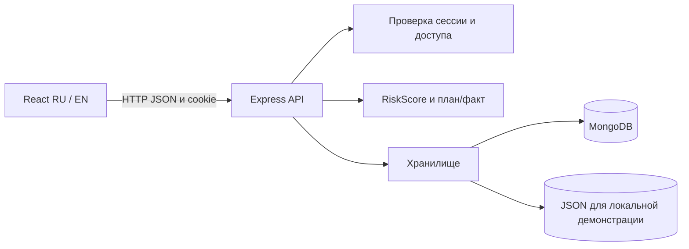

# Архитектура Orbit

Orbit объединяет планирование командной работы, учёт фактического прогресса и объяснимую оценку рисков. Обзор функций и правил работы приведён в [FEATURES.md](FEATURES.md).



В рабочем режиме сервер обслуживает собранный интерфейс и API с одного адреса. В режиме разработки Vite передаёт запросы `/api` серверу. Клиент не обращается к MongoDB напрямую.

## Данные

| Сущность | Основные поля и назначение |
| --- | --- |
| Пользователь | `id`, имя, email, роль и доступная нагрузка; пароль хранится как хеш |
| Проект | `id`, название, описание, цвет, статус, даты и `memberIds` |
| Задача | `id`, `projectId`, статус, приоритет, исполнитель, даты, плановые и фактические часы, прогресс |
| Подзадача | Вложенные в задачу `id`, название и признак завершения |
| Комментарий | Вложенные в задачу текст, автор и время; до 500 комментариев на задачу |
| Зависимость | Идентификатор другой задачи того же проекта |
| Событие | Проект, задача, тип изменения, автор и время |
| Снимок | Проект, имя, время, агрегированные показатели и сохранённое состояние задач |

Идентификаторы передаются через API строками. История событий и снимки вынесены из задач, чтобы запись задачи не росла при каждом изменении. Вычисляемый `risk` содержит числовой балл, уровень и вклад отдельных факторов.

## Доступ

Авторизация проверяется сервером. Роль и участие в проекте определяют доступ к данным; скрытая кнопка в интерфейсе не считается защитой. Исполнитель меняет разрешённые поля своей задачи, менеджер управляет проектной работой, администратор обладает расширенными правами.

Пароли хешируются с солью. Cookie сессии недоступна JavaScript. При размещении за пределами локального компьютера нужны HTTPS, секреты окружения, закрытый доступ к базе и резервное копирование. Демонстрационная учётная запись предназначена для локального знакомства с приложением.

## RiskScore

```text
score = 0.30 × deadline
      + 0.25 × progress
      + 0.20 × workload
      + 0.15 × blocked
      + 0.10 × inactivity
```

Компоненты ограничены диапазоном 0…1. Риск завершённых задач равен нулю. Результат объясняется через компоненты: близость срока, отставание от ожидаемого прогресса, нагрузку исполнителя, незавершённые зависимости и отсутствие обновлений.

| Компонент | Правило реализации |
| --- | --- |
| Deadline | Для просроченной задачи 1; иначе `clamp(1 − оставшиесяДни / 7)` |
| Progress | `clamp((плановыйПрогресс − фактическийПрогресс) / 100)` |
| Workload | `clamp(оставшиесяЧасы / capacityHours − 1)` |
| Blocked | 1 для статуса blocked или хотя бы одной незавершённой зависимости; иначе 0 |
| Inactivity | `clamp(дниСПоследнегоИзменения / 7)` |

`clamp(x)` ограничивает значение диапазоном 0…1. Уровень low соответствует баллу ниже 0,35, medium: от 0,35 включительно до 0,65 не включительно, high: от 0,65 включительно. Итог округляется до трёх знаков после запятой. Расчёт находится в `shared/metrics.js` и принимает время аргументом для воспроизводимых тестов. Сервер и интерфейс используют общие правила планового и фактического прогресса.

Для нагрузки суммируются оставшиеся часы незавершённых задач исполнителя, начало которых не позже текущей даты плюс семь суток. Оставшиеся часы равны `plannedHours × (1 − progress / 100)`. Это оценка очереди работ относительно недельной вместимости `capacityHours`, а не почасовой календарь: распределение длинной задачи по отдельным дням не моделируется.

RiskScore помогает определить порядок проверки задач. Он не заменяет решение менеджера и не является прогнозом, обученным на исторических данных.

Актуальные значения пересчитываются при получении задач и аналитики. При редактировании задачи переход в high фиксируется событием `risk.high`. Отдельная коллекция предупреждений, фоновый планировщик и внешние уведомления не используются. Риск зависимых задач и задач того же исполнителя может измениться при следующем чтении без отдельного события перехода для каждой из них.

## План и факт

Плановый прогресс линейно растёт от 0 до 100 по интервалу между началом задачи и концом дня её срока. Календарные даты интерпретируются как UTC; выходные и праздники не исключаются. Фактический прогресс задаёт исполнитель. Прогресс проекта взвешивается по плановым часам задач; если все оценки нулевые, используется простое среднее. Разность фактического и планового прогресса показывает отставание или опережение; разность фактических и плановых часов: отклонение трудозатрат.

Снимок сохраняет значения на конкретный момент, включая средний риск и количество просроченных задач. Средний риск: арифметическое среднее RiskScore всех задач проекта, в том числе нулевого риска завершённых задач. Последующие изменения задач не меняют сохранённые показатели. Сравнение двух снимков показывает изменение состояния между выбранными контрольными точками. Для процентов разность выражается в процентных пунктах.

## Локализация

Интерфейс поддерживает русский и английский языки с сохранением выбора в браузере. Переводятся навигация, действия, состояния, подписи форм и системные сообщения. Пользовательские названия и описания сохраняются в исходном виде.

## Эксплуатация

JSON-режим позволяет запустить демонстрацию без внешней базы. Файл `.data/orbit.json` сохраняется через временный файл и переименование; операции записи последовательно выполняются в одном процессе. `STORE=file` явно выбирает файл, `STORE=mongo` требует `MONGODB_URI`. Если `STORE` не задан, наличие `MONGODB_URI` включает MongoDB. В MongoDB используются отдельные коллекции `users`, `projects`, `tasks`, `project_events` и `project_snapshots`, уникальные индексы идентификаторов и email, индексы задач и событий проекта.

В режиме MongoDB endpoint `/api/analytics/:projectId` использует aggregation pipeline для количества задач, завершённых задач, сумм часов, взвешенного прогресса и распределения по статусам. RiskScore, ожидаемый прогресс, нагрузка и снимки вычисляются общим модулем приложения. В файловом режиме все показатели вычисляются этим модулем.

Текущий адаптер держит рабочее состояние в памяти процесса и сохраняет изменения в выбранное хранилище. Поэтому приложение следует запускать в одном экземпляре сервера. Изменения нескольких коллекций MongoDB не объединены в общую транзакцию; горизонтальное масштабирование и отказоустойчивые транзакции требуют развития адаптера. При ошибке записи MongoDB адаптер перечитывает состояние из базы, однако это не отменяет уже выполненные частичные записи.

Секреты и рабочие данные не должны попадать в Git. Снимок проекта: инструмент аналитики, а не резервная копия базы данных.

Команды установки, запуска и проверок приведены в корневом README. Результаты выполненных проверок доступны в [VERIFICATION.md](VERIFICATION.md).

Контракт HTTP-интерфейса описан в [API.md](API.md).
